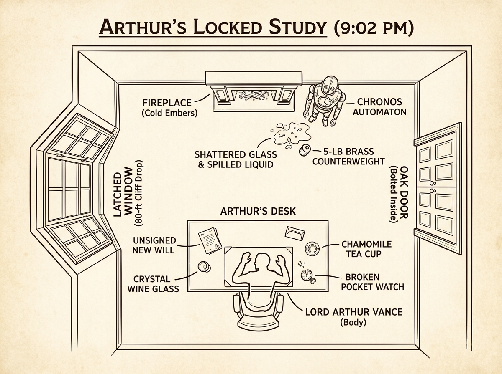

# Evidence Packets — *The Last Chime of Ravenshollow*

Print these exhibits (or project them via `companion/index.html`) and reveal them at the start of each Act.

---

## MANOR MAP (Always Visible on the Evidence Board)

```text
+-------------------------------------------------------------------+
|                     SECOND FLOOR (THE STUDY WING)                 |
|  +-------------------------+   +-------------------------------+  |
|  |   ARTHUR'S LOCKED STUDY |   |    UPSTAIRS GALLERY / HALL    |  |
|  |  [Desk]  [Automaton]    |===|  (Oak Door: Bolted Inside)    |  |
|  |  [Fireplace]  [Cliff    |   |  [Laundry Chute]  [Stairs]    |  |
|  |                Window]  |   +-------------------------------+  |
|  +-------------------------+                                      |
+-------------------------------------------------------------------+
|                       GROUND FLOOR (GALA)                         |
|  +-------------------------+   +-------------------------------+  |
|  |       GRAND HALL        |   |      DINING / SIDEBOARD       |  |
|  |  [Astronomical Clock]   |   |  [Wine Decanter]  [Kitchen]   |  |
|  |  [Champagne Station]    |   +-------------------------------+  |
|  +-------------------------+   |   BASEMENT: GENERATOR ROOM    |  |
|                                +-------------------------------+  |
+-------------------------------------------------------------------+
```

---

## ACT I EVIDENCE (Reveal at Start of Act I)

### Study Crime Scene Sketch (9:02 PM)
*Presented by: Act I*



> - **Door:** Heavy oak, steel deadbolt engaged from the **inside**. Forced open at 9:01 PM.
> - **Window:** Latched from the inside; sheer 80-foot drop to coastal rocks.
> - **The Body:** Lord Arthur Vance found slumped across his leather desk blotter. First reached and rolled over by Dr. Julian Mercer at 9:01 PM.
> - **On the Desk:**
>   1. The **New Will** — lying open, **unsigned**.
>   2. A **crystal wine glass** filled with red wine.
>   3. A single poured porcelain **cup of chamomile tea** — **barely lukewarm** by 9:02 PM.
>   4. A **broken pocket watch** on the desk corner.
> - **On the Floor (below the Chronos Automaton):**
>   - **Shattered glass** in a pool of **spilled liquid**.
>   - A heavy **brass counterweight** resting beside the shattered glass.

---

### Arthur's Shattered Pocket Watch
*Presented by: Act I — Introduced by Witness (e.g., Thomas Graves #3)*

> **Recovered from the corner of Arthur's desk at 9:02 PM**
>
> - **Make:** Custom Vance Precision Gold Chronometer (engraved *"A.V. — Time Never Lies"*).
> - **Condition:** Glass crystal cracked cleanly across the face; internal escapement jammed from impact against the desk corner.
> - **Frozen Time:** **`8:48 PM`** (precisely 12 minutes before the 9:00 PM blackout).
> - **Note:** Dr. Julian Mercer snapped the gold lid shut at 9:02 PM, stating Arthur's watch "always ran twelve minutes slow."

---

## ACT II EVIDENCE (Reveal at Start of Act II)

### Charred Audit Log
*Presented by: Act II — Introduced by Inspector (e.g., Harriet Vance-Cole #8)*

> **Pulled half-burned from the cold embers of the Study fireplace**
>
> ```text
> VANCE PRECISION INSTRUMENTS — CONFIDENTIAL INTERNAL AUDIT
> ARCHIVE BOX #4 (SLATED FOR PUBLIC RELEASE WITH NEW WILL)
> ---------------------------------------------------------
> SUBJECT:   2008 St. Jude's Clinic — Surgical Pump Trial
> INCIDENT:  Patient fatality (Nov 2008); valve dosing error
> FINDING:   Calibration Log 08-B was deliberately FALSIFIED
>            to conceal operator negligence.
> SIGNED BY: "J.M." [REST OF LINE BURNED]
> STATUS:    Suppressed by A. Vance (2008). Full disclosure
>            ordered upon execution of New Will.
> ```

---

### Chronos Automaton, Wax Cylinder & Study Re-Inspection
*Presented by: Act II — Introduced by Clockwork Witness (e.g., Celeste Moreau #7)*

> - **Device:** *The Chronos Automaton* — a 4-foot brass clockwork figure mounted beside Arthur's desk.
> - **Programmable Triggers:**
>   1. **Phonograph Drum:** Plays a removable brass wax cylinder at a scheduled minute. Currently set to **`8:55 PM`**.
>   2. **Release Cam:** Drops a 5-pound brass counterweight onto a resonance chime (or directly onto the desk edge if shifted 2 inches) at **`9:00 PM`**.
> - **Cylinder Found Inside:** Paper label reads *"9:00 PM Gala Greeting"*, **but** the label is peeling and has been hastily glued over a scratched-out title: *"Memoir Draft — Confrontation."*
> - **Study Re-Inspection (Clear Light):** The crystal wine glass on the desk is **completely full and untouched**; the shattered vessel on the floor is a **glass water carafe** in a puddle of **clear, completely odorless liquid** (zero wine, zero bitter-almond odor). Desk-blotter impressions confirm Arthur collapsed **face-down, facing away from the door** until Dr. Julian Mercer rolled him over.

---

### Crumpled Generator Note
*Presented by: Act II*

> *Found crumpled on the basement stairs as guests regrouped before Act II:*
>
> ```text
> "9:00 PM sharp. Pull the main breaker. Don't let anyone see you. — V."
> ```

---

## ACT III EVIDENCE (Reveal at Start of Act III)

### 2008 Dossier Ledger & Horologist Journal
*Presented by: Act III*

> **Unlocked from Arthur's private desk drawer**
>
> **1. Vance Precision Instruments — Selected 2008 Archive & Employment Records:**
> - *Lady Evelyn Vance:* Director of Vance Charity Gala Fund (**2006–2008**)
> - *Clara Sterling (Estate Attorney):* Lead Trust Counsel, Vance Legal Holdings (**2005–present**)
> - *Thomas Graves (Head Butler):* Estate Steward & Keyholder, Ravenshollow (**1999–present**)
> - *Dr. Julian Mercer (Personal Physician):* Retained **2009** *(Prior post: Chief Resident, **St. Jude's Clinic, 2006–2008**)*
> - *Victor Vance:* Junior Commodities Broker, Vance Capital (**2007–2008**)
> - *Jasper Moore (Chief Engineer):* Hired **2012** *(Graduated MIT Engineering, **2011** — no access to Archive Box #4 in 2008)*
>
> **2. Excerpt from Arthur Vance's Personal Horologist Journal (Nov 15):**
> > *"A clockmaker whose own pocket watch loses a single second is a fraud. As always, my gold chronometer is calibrated every morning at 7:00 AM to the U.S. Naval Observatory signal. It has not drifted by half a second in eleven years."*

---

### Field Toxicology Report
*Presented by: Act III — Introduced by Inspector (e.g., Harriet Vance-Cole #8)*

> - **Sample 1 (Red Wine in Dining Sideboard Decanter & Untouched Study Glass):** Tests positive for **Chloral Hydrate** (a non-lethal sleeping sedative). *Conclusion: Someone tried to drug Arthur's wine to put him to sleep, NOT kill him—and Arthur never drank it.*
> - **Sample 2 (Trace Residue on Arthur's Lips & Shirt Cuff):** Tests positive for **Concentrated Aconite** (fast-acting, completely **odorless** cardiac poison; fatal within **2–3 minutes** of ingestion).
> - **Sample 3 (Puddle on Floor):** Plain spring water. Zero wine, zero poison, zero bitter-almond odor.

---

### Anonymous Library Rumor
*Presented by: Act III*

> *Found slipped under the Library door before Act III:*
>
> ```text
> "Check the Dining & Sideboard! Someone wiped down the Bordeaux decanter left on the sideboard with an almond-scented handkerchief right before 9:00 PM."
> ```
